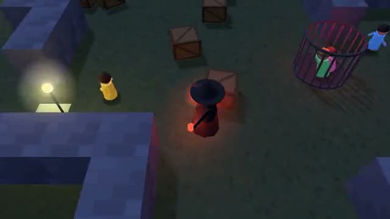

# Hunter vs Four

Fix the generators. Open the gate. Don't get caught. A multiplayer starter game from [Multiplayer Agent](https://multiplayeragent.com): 3D, party, 2–5 players, with bots that fill empty seats on both sides.

## How it plays

Four survivors stand still at generators to fix them while the hunter prowls the yard. Fix three and the gates open: get out. Caught survivors go to the cage until a friend stands next to it and lets them out. The hunter wins if most of them never leave.

**Controls:** WASD or hold the mouse to walk, Shift to run, Space to lunge as the hunter, or the touch stick and buttons.

## Make it yours in the Game Builder

Open the [Game Builder](https://multiplayeragent.com), choose **Start from a starter game** and pick Hunter vs Four. It opens as version 1 in your studio, ready to play and publish. Then ask for changes, for example:

- Add lockers survivors can hide in
- Make the hunter invisible until it's close
- Add a flashlight that stuns the hunter for a second

## Run it yourself

1. Get a free publishable key (`pk_…`) at [multiplayeragent.com](https://multiplayeragent.com).
2. In `index.html`, put it in place of `pk_REPLACE_ME` in the `MP_CONNECT` block.
3. Serve the folder (for example `npx serve`) and open it. The 3D engine loads as a module, which browsers block from a file on disk.

Without a key it still runs, offline against bots.

## How it is built

- One `index.html` plus three.js in `libs/`. The comment at the top of the script maps the code and explains the multiplayer.
- **Host-run rules:** The host's browser decides repairs, catches, rescues and escapes; if it leaves, the next player takes over.
- **Bots:** Bots fill both sides: survivors fix, flee and rescue; a bot hunter listens for running and rattling generators.
- **Live sync:** Every survivor, generator, cage and gate is the same for everyone.
- **Not secret:** The hunter's screen hides survivors it can't see, but every position is in the room state, so dev tools would show them.
- **Leaderboard:** The most points anyone scored in one night.
- `?attract` runs it offline with bots only. The preview video is recorded from it.

## License

MIT. three.js in `libs/` is MIT too (Copyright 2010-2024 three.js authors).
